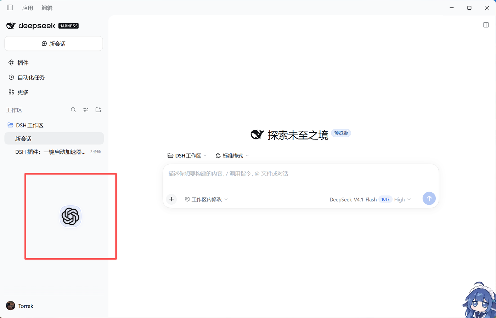
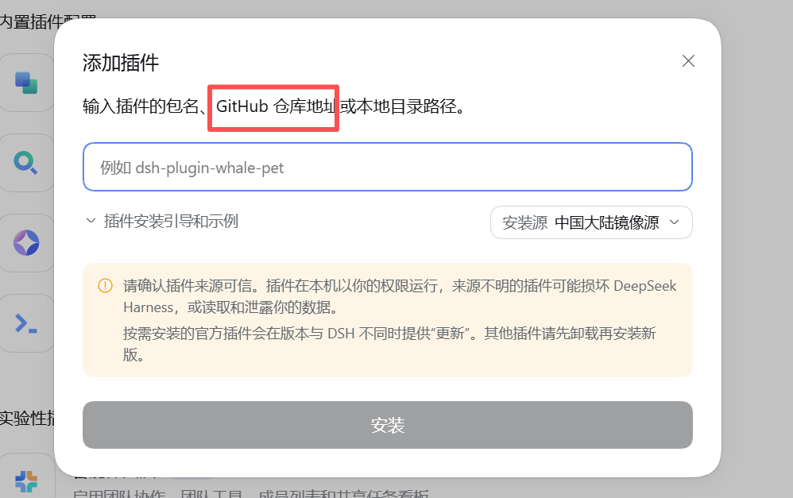

# GPT_Button —— DSH 快速启动插件

在 [DeepSeek Harness（DSH）](https://github.com/deepseek-ai) 桌面客户端左下角放一枚**圆形 GPT 图标**：
**左键一键启动**（加速器 → ChatGPT 桌面端），**右键**弹出「路径配置 / 重启」菜单。
图标会在窗口里缓慢漂浮、碰边 Q 弹回弹，背景是 DeepSeek 风格渐变蓝 × 10% 不透明度，能透出后面的文字。

## ✨ 在 DSH 里直接安装

打开 DSH 桌面端 → **插件管理 → 添加插件**，粘贴本仓库地址即可（网络慢可切换「中国大陆镜像源」）：

```
https://github.com/Tkxyz1122/GPT_Button
```

本仓库根目录就是插件包（`package.json` 在根上），因此**不需要下载解压**，直接用仓库地址安装。



> 图中左下角红框处就是本插件的圆形按钮，其余部分为 DSH 主界面。

> Windows 平台专用（依赖 `tasklist`、商店应用 AUMID 等 Windows 能力）。

## 功能

- 🚀 **一键连招**：按「加速器 →（可配延迟，默认 500ms）→ ChatGPT」顺序启动
- 🟢 **透明圆形按钮**：DeepSeek 渐变蓝、约 10% 不透明度，能透出背后的文字；浅色/深色主题自动适配图标颜色
- ⏱ **3 秒后淡入**：打开界面后先隐藏，3 秒后用 0.8s 的淡入 + 缩放动画轻轻出现
- 🪄 **随机漂浮**：在窗口内缓慢漂移（约 20–36 px/s），默认只在**左侧栏**范围活动，可切换「全窗口」；碰边反弹 + Q 弹挤压动画；拖动后 30 秒内不漂移；可关闭
- 🖱️ **右键菜单**：路径配置 / 重启 <加速器名> / 重启 ChatGPT（重启 = 结束进程 → 等待 → 重新启动）
- 🏷️ **名称自动读取**：显示名与进程名都从配置路径推导（读 exe 文件版本信息，读不到用文件名），换路径不用手改
- ⚙ **路径配置面板**：加速器路径（.exe / .lnk）、ChatGPT AUMID、启动间隔、随机漂浮开关、漂浮范围
- 🔎 **自动检测**：读取 Falemon 路径与商店版 ChatGPT 的 AUMID（`Get-AppxPackage`）
- 🧲 按钮可拖动，位置保存在本机 `localStorage`

## 环境要求

| 项目 | 要求 |
|---|---|
| 操作系统 | Windows 10 / 11 |
| 宿主 | DSH 桌面客户端（Electron），或 `dsh web` |
| 程序 | 一个加速器（默认配置为 Falemon）；ChatGPT 桌面端（微软商店版，包名 `OpenAI.Codex`） |

> 本插件默认按「Falemon 加速器 + 商店版 ChatGPT」的路径/包名配置，其他程序可在「路径配置」里改。

## 安装（桌面客户端）

1. 打开 DSH 桌面客户端 → **插件管理 → 添加插件**；
2. 输入以下任意一种来源：
   - **GitHub 仓库地址**（推荐）：`https://github.com/Tkxyz1122/GPT_Button`
   - **本地目录**：本仓库根目录（包含 `package.json` 的那一层）
3. 点「安装」，完成后**完全退出客户端（含系统托盘）再打开**；
4. 左下角 3 秒后淡入出现圆形 GPT 按钮。



> 桌面端 profile 由客户端托管，命令行 `dsh plugin` 不接受 `--profile desktop`，必须走界面安装。
> 本仓库根目录即插件包，所以「GitHub 仓库地址」和「本地目录」两种方式都能装。

## 安装（dsh web）

```powershell
dsh plugin --profile web add link:<本仓库绝对路径>
```

装完重启 `dsh web` 并刷新页面。

## 使用

| 操作 | 效果 |
|---|---|
| 左键单击 | 一键启动（加速器 → 延迟 → ChatGPT），按钮转圈提示 |
| 右键 | 菜单：路径配置 / 重启加速器 / 重启 ChatGPT |
| 拖动 | 只移动位置，不会触发启动；拖完后 30 秒内不再漂浮 |
| 悬停 | 按钮暂停漂浮、放大并发光 |

### 路径配置

右键菜单 →「路径配置」，可修改：

- **加速器程序路径**：`.exe` 或 `.lnk`，保存时校验文件是否存在
- **ChatGPT AUMID**：商店应用的「包族名!AppId」，默认 `OpenAI.Codex_2p2nqsd0c76g0!App`
- **启动间隔**：加速器启动后等待多少毫秒再开 ChatGPT（默认 500，0 = 同时）
- **随机漂浮**：开关
- **漂浮范围**：左侧栏（默认）/ 全窗口

## 配置文件

设置保存在 `%USERPROFILE%\.dsh\.dsh-launch.json`（可用环境变量 `DSH_HOME` 改数据根目录）：

```json
{
  "version": 1,
  "delayMs": 500,
  "float": true,
  "floatRange": "left",
  "apps": {
    "accelerator": {
      "label": "",
      "enabled": true,
      "kind": "exe",
      "path": "D:\\_App\\FalemonVPN\\Falemon.exe",
      "processName": ""
    },
    "chatgpt": {
      "label": "ChatGPT",
      "enabled": true,
      "kind": "aumid",
      "aumid": "OpenAI.Codex_2p2nqsd0c76g0!App",
      "processName": "ChatGPT.exe"
    }
  }
}
```

- `label` / `processName` 留空 = 自动推导，换路径不用手改
- `floatRange`：`"left"` 左侧栏 / `"full"` 全窗口
- `kind`：`exe` / `lnk` / `url` / `aumid`

## 目录结构

```text
GPT_Button/                      ← 仓库根目录 = 插件包
├── README.md                    # 本文件
├── LICENSE                      # MIT
├── CHANGELOG.md
├── .gitignore / .gitattributes
├── package.json                 # DSH bundle 元数据
├── cordis.patch.yml             # 挂载声明
├── icon.png                     # 插件列表图标（火箭）
├── lib/index.js                 # 宿主半区：路由 + 启动/重启/配置
├── assets/
│   ├── launcher-widget.js       # 前端半区：圆形按钮 + 菜单 + 配置面板
│   └── gpt-icon.png             # 悬浮按钮上的 GPT 图标
├── docs/
│   ├── preview.png              # 界面效果截图
│   ├── install.png              # 「添加插件」界面截图
│   └── plugin-internal.md       # 插件内部说明（路由/配置/排错）
├── scripts/
│   ├── convert-gpt-icon.py      # .ico → gpt-icon.png
│   ├── make-plugin-icon.py      # 生成插件列表用的火箭图标
│   └── sync-to-dsh.ps1          # 本地开发：把插件同步到已安装位置
└── test/
    └── smoke-test.mjs           # 用模拟宿主跑路由冒烟测试
```

### 两个图标分别是干什么的

| 文件 | 用途 |
|---|---|
| `icon.png` | **插件管理列表**里的图标（小火箭，由 `scripts/make-plugin-icon.py` 生成），不影响按钮外观 |
| `assets/gpt-icon.png` | **悬浮按钮本体**上的 GPT 标志（由 `scripts/convert-gpt-icon.py` 从 .ico 转换） |

## 开发

- 改前端 `assets/launcher-widget.js`：**刷新页面（F5）即生效**
- 改宿主 `lib/index.js`：需要**重启 DSH 客户端**
- 图标：`python scripts/convert-gpt-icon.py <源.ico>`；插件列表图标：`python scripts/make-plugin-icon.py`
- 冒烟测试（不会真的启动程序）：

```powershell
node test/smoke-test.mjs
# 期望输出 SMOKE_OK，且 state.json 返回 200
```

- 本地同步到已安装的插件目录：

```powershell
powershell -File scripts/sync-to-dsh.ps1
# 或指定目标：
powershell -File scripts/sync-to-dsh.ps1 -Destination "D:\你的\插件安装目录"
```

- 插件内部说明（路由清单 / 配置字段 / 排错）见 [`docs/plugin-internal.md`](docs/plugin-internal.md)

## 安全说明

- 插件的所有路由只接受**本机回环地址**（127.0.0.1 / localhost / ::1）的请求，拒绝跨站标记与不同源请求；
- 修改配置只接受来自本机的请求，避免任意网页改写启动路径；
- 只会启动配置文件中指定的程序，不执行任意命令；
- 商店应用不能直接 spawn exe，插件通过 `explorer.exe shell:AppsFolder\<AUMID>` 启动。

## 已知限制

- 仅支持 Windows；
- ChatGPT 通过 AUMID 启动，若商店包名变化需在「路径配置」里更新；
- 需要管理员权限的程序首次启动仍会弹 UAC，插件无法静默提权；
- 加速器若自带「最小化到托盘」逻辑，插件不做窗口干预。

## 许可与商标

代码以 [MIT](LICENSE) 协议开源。

ChatGPT 名称与标志为 OpenAI 的商标/版权资源，本仓库仅为个人本地使用示例，与 OpenAI 无关联；
若你需要公开分发，请自行替换为可再分发的图标。

## 致谢

- 插件机制参考 DSH 生态中的 bundle 插件写法（`dsh.bundle.patch` + `cordis.patch.yml`）；
- 交互参考了 `dsh-whale-widget` 的桌面注入方式（`webserver/index-inject`）。
